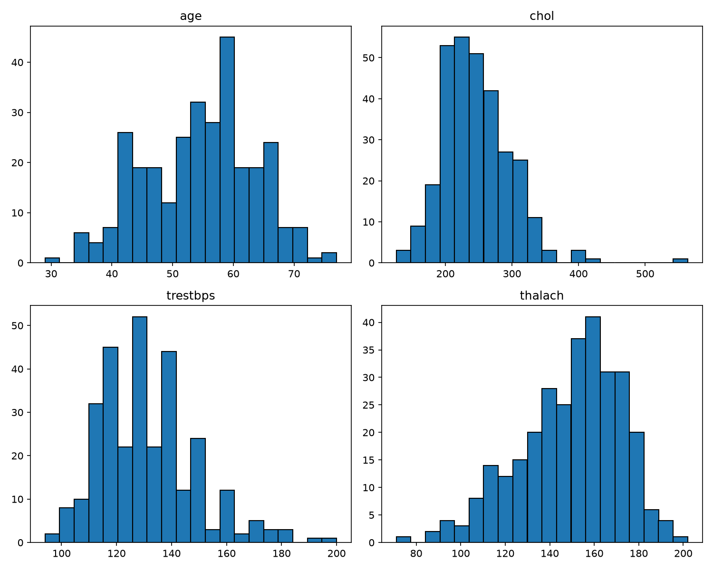
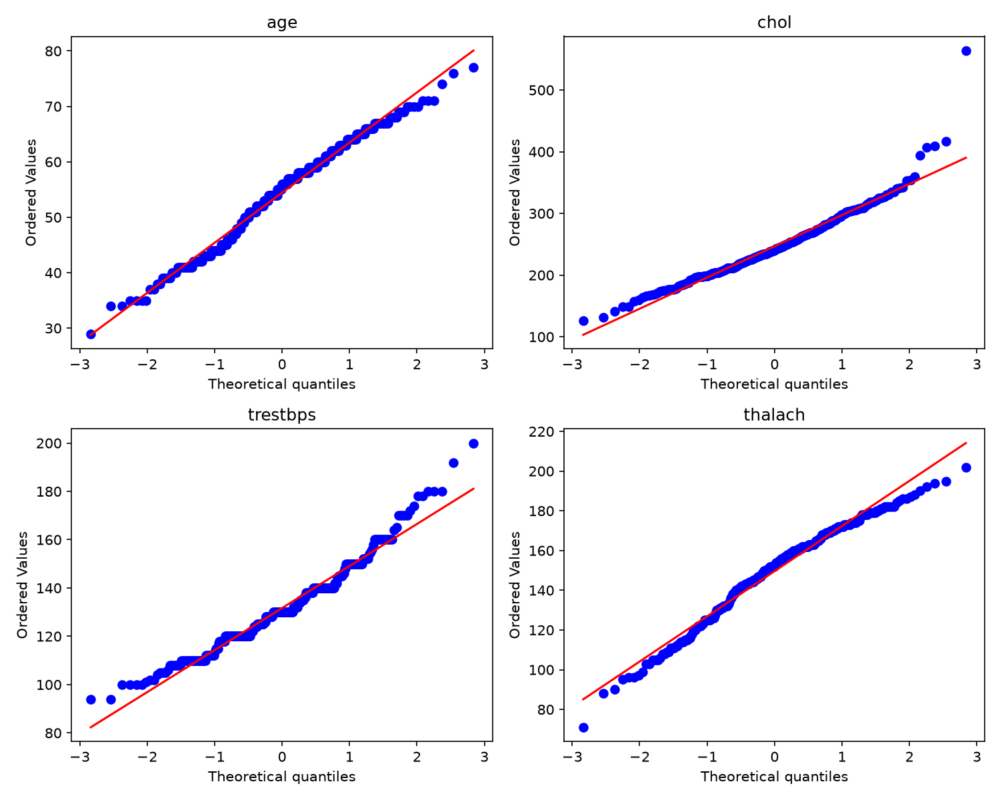
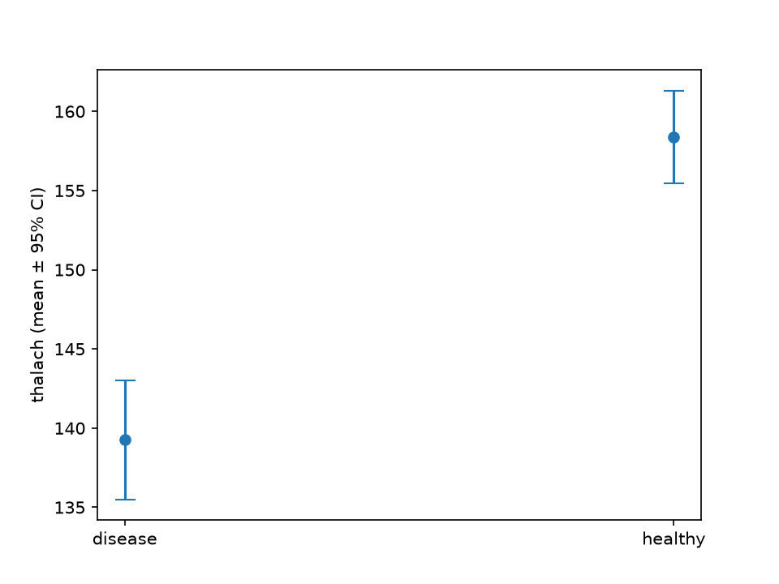
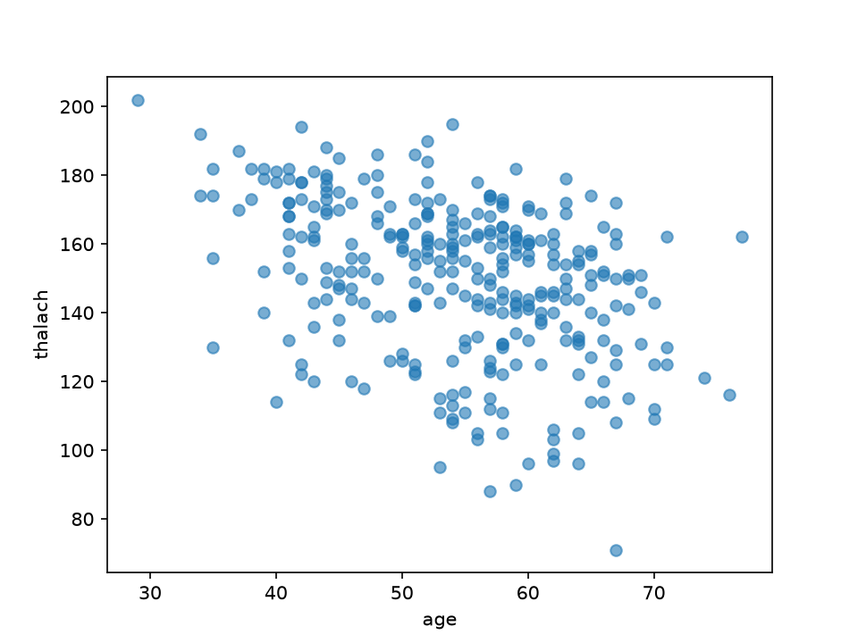
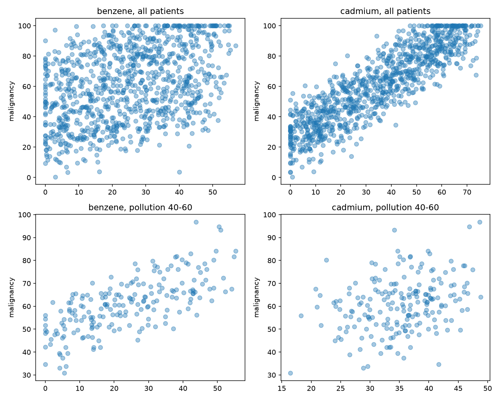

# CSPC - Computer Science for Physics and Chemistry

My coursework repository. Each practical is under PW<n>/Lab <X>/.

## Setup

Create the environment for a given lab:

    conda env create -f PW<n>/Lab\ <X>/environment.yml
    conda activate cspc

---

## PW1 - Lab A: Reproducible Foundations

**What I built:**
- A radioactive decay simulation (pure-Python loop and NumPy vectorised versions), a pytest test suite, and a speed comparison script.

**Speed comparison (loop vs NumPy):**
- loop  : 2.5065 s
- numpy : 0.0002 s
- speed-up: 11542.4x faster

**Tests:** all passing? yes

**Conclusion:**
- The NumPy vectorised version is dramatically faster than the pure-Python loop because it replaces per-atom Python-level iteration with a single vectorised binomial draw across all surviving atoms at once. This showed me how much overhead plain Python loops carry compared to array operations. Setting up conda, git branching, and pushing to GitHub also helped me understand the full reproducible workflow.

## PW1 --- Lab B

The observed data shows an exponential decay from about 5000 counts at t=0 
down to roughly 330 counts by t=9. Comparing the observed data (scatter) 
to the analytical curve N0*exp(-λt) with λ=0.3, the two shapes match closely, 
confirming the data follows the expected exponential decay law.

The Snakemake pipeline (Snakefile) has one rule that regenerates figure.png 
from decay_observed.csv by running plot.py, and only reruns it when the 
input data or script changes.

## PW2 --- Lab A

### Results

- Mean acceleration: -8.58 m/s²
- Acceleration standard deviation: 28.72 m/s²
- Largest difference in recovered position: 0.785 m

### Noise observation

The acceleration is much noisier than the position because differentiation amplifies measurement noise. Since acceleration is obtained by differentiating the position data twice, the noise becomes much larger.

### Integration back

I integrated the noisy acceleration back to velocity and then to position. The recovered position was close to the original position, with a largest difference of 0.785 m. This shows that integration suppresses some of the noise.

## Bonus --- 2D Trajectory

### Results

- Mean speed: 23.65 m/s

### Analysis

The trajectory data contains the x and y positions of the object over time. I calculated the velocity components using numerical differentiation and then calculated the total speed from the x and y components.

The mean speed was 23.65 m/s. I also generated a 2D trajectory plot and a speed-versus-time plot.

## PW3 - Data, Distributions, Testing, Causation

### Data

Dataset 1: Heart Disease (Cleveland), Kaggle / UCI: https://www.kaggle.com/datasets/ritwikb3/heart-disease-cleveland (303 patients).

Dataset 2: chemicals_cancer.csv, a synthetic dataset from the course (1000 patients, columns: benzene, cadmium, pollution_index, age, malignancy).

Files are in the PW3 folder: session1.py, session2.py, chem.py and the plots.

### Session 1

#### Distributions

I loaded Heart_disease_cleveland_new.csv (the heart dataset from Kaggle) with pandas and plotted histograms of age, chol, trestbps and thalach.

- age: roughly bell-shaped but a little uneven. Most patients are between 40 and 65, with a peak around 58-60.
- chol: skewed to the right. Most values are between 200 and 300, and a few are very high (one above 550).
- trestbps: skewed to the right. Most values are between 110 and 150, a few go up to 200.
- thalach: skewed to the left. Most values are between 130 and 175, and there is a tail of low values down to about 70.

#### Normality

I used three checks: the histogram, the Q-Q plot and the Shapiro-Wilk test (normal if p > 0.05). I also looked at the skewness.

| variable | Shapiro-Wilk W | p-value | skewness | verdict |
|---|---|---|---|---|
| age | 0.986 | 0.0061 | -0.21 | approximately normal |
| chol | 0.947 | < 0.0001 | 1.13 | not normal |
| trestbps | 0.967 | < 0.0001 | 0.70 | not normal |
| thalach | 0.976 | 0.0001 | -0.53 | not normal |

- age: the p-value is below 0.05, but W is very close to 1 and the skewness is small. With 303 patients the test is very sensitive, so I decided that age is approximately normal.
- chol: long tail of high values and a high skewness, so it is not normal.
- trestbps: clearly skewed to the right, so it is not normal.
- thalach: skewed to the left, so it is not normal.

Because thalach is not normal, I used tests that do not need a normal distribution in Session 2.

### Session 2

#### Heart rate: disease vs healthy

I split thalach into two groups using target: 139 patients with heart disease and 164 healthy patients. Since thalach is not normal, I used the Mann-Whitney U test. Result: U = 5806.5, p = 1.9e-13. The p-value is much smaller than 0.05, so the two groups really differ: patients with heart disease have a lower maximum heart rate. (A Welch t-test gives the same answer, p = 9.1e-14.)

#### Mean and uncertainty

| group | mean thalach | standard error | 95% interval |
|---|---|---|---|
| disease | 139.3 | 1.92 | 135.5 - 143.0 |
| healthy | 158.4 | 1.50 | 155.4 - 161.3 |

The 95% interval is the mean +/- 1.96 standard errors. The two intervals do not overlap, so the plot agrees with the test: the groups are different.

#### Age vs heart rate

I used the Spearman correlation because thalach is not normal. Result: rho = -0.39, p = 1.5e-12. The relationship is negative and moderate: older patients tend to have a lower maximum heart rate, but there is a lot of spread.

### Chemical mystery

#### Naive conclusion

I computed the correlation between each chemical and malignancy for all 1000 patients. Benzene: r = 0.38. Cadmium: r = 0.88. Cadmium is much more strongly associated with malignancy, so at face value cadmium looks like the cause.

#### Conclusion after controlling for the confounder

A third variable, pollution_index, could influence both the chemicals and malignancy. To test this, I kept only patients with similar pollution (pollution_index between 40 and 60, 199 patients) and computed the correlations again.

| | all patients | pollution 40-60 |
|---|---|---|
| benzene | 0.38 | 0.70 |
| cadmium | 0.88 | 0.32 |

The cadmium association drops a lot, while the benzene association stays strong.

#### Which chemical really causes malignancy and how I know

Benzene is the real cause. Cadmium only looked guilty.

The correlation table shows why: pollution_index is almost perfectly correlated with cadmium (r = 0.98) and strongly correlated with malignancy (r = 0.90), but not with benzene (r = 0.05). So pollution drives both cadmium and malignancy, which creates a false link between cadmium and malignancy. When patients have similar pollution, most of this false link disappears. Benzene is independent of pollution, so its link with malignancy cannot come from pollution. Age is not related to any variable (all correlations close to 0). The cadmium correlation does not drop to exactly zero because pollution still varies a little inside the 40-60 range.

### Bonus: how unpredictable is a category?

The target column has 54.1% of 0 (no disease) and 45.9% of 1 (disease). I measured the Shannon entropy: H = 0.995 bits. The maximum for two categories is 1 bit, so the column is almost perfectly balanced and a category is hard to guess.